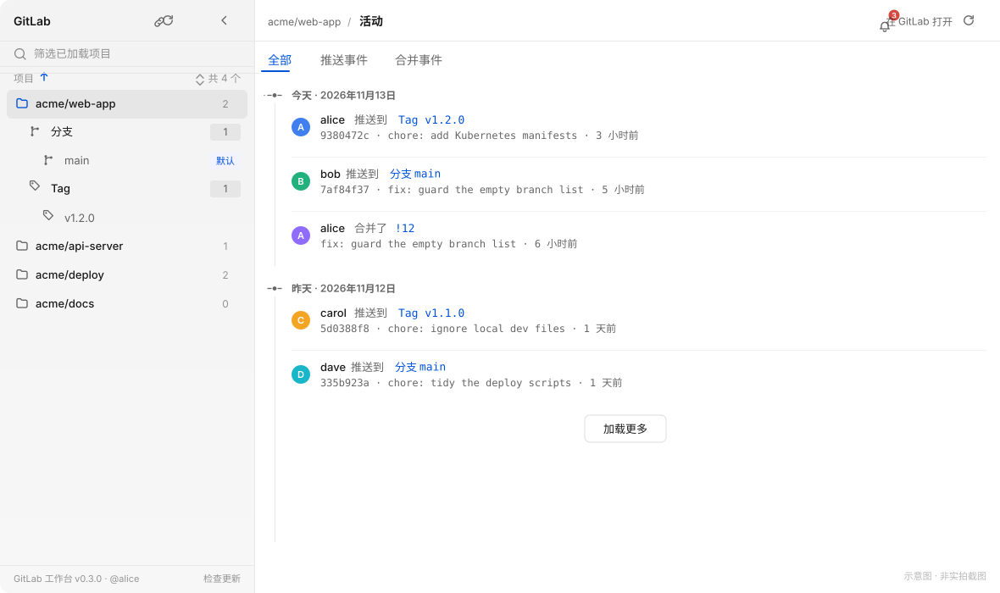

# GitLab 项目工作台（DSH 插件）

在 DSH 侧边栏里浏览 GitLab：左侧是项目树，展开看分支 / Tag；右侧是项目的活动流和提交历史。左侧栏与禅道插件（`@local/dsh-zentao`）使用同一套布局和主题变量。

> 上图是**界面结构示意图**（SVG 绘制，项目名与人名均为虚构），不是实拍截图。真实界面配色、间距与它一致。

## 安装

在 DSH 的 **Plugins** 里选 **Add plugin**，选中本目录；或由 agent 用 `plugin_manager` 的 `install_bundle` 安装本目录。

安装后侧边栏会多出一个分支图标，点开就是工作台。

## 首次连接

面板右侧填 GitLab 地址 + Personal Access Token（`read_api` 即可）。令牌保存到 DSH 凭据库的 `DSH_GITLAB_TOKEN`；没有凭据服务时保存到 `~/.dsh/gitlab/settings.json`（0600）。

Host 侧会先校验再写入，换地址时必须重新输入令牌，避免把已有令牌发到别的地址。

## 结构

| 文件 | 作用 |
|---|---|
| `index.js` | Host 侧：`/gitlab/api` 同源接口（config / settings / me / projects / refs / commits），托管所有 GitLab 请求与令牌 |
| `lib/gitlab-api.js` | GitLab REST v4 只读客户端（项目、分支、标签、提交，带分页、超时、错误翻译；不跟随重定向） |
| `lib/settings.js` | 没有凭据服务时的本地兜底存储（0600） |
| `lib/activity.js` | 活动通知：按项目记录事件水位、生成通知、存 `~/.dsh/gitlab/activity.json` |
| `client.js` | 浏览器侧：`sidebar.panellist` 图标 + `main` 面板，左右结构与交互 |
| `cordis.patch.yml` | 插件行与默认 `baseUrl` |

## 配置项

| 字段 | 默认 | 说明 |
|---|---|---|
| `baseUrl` | `https://gitlab.example.com` | GitLab 实例地址，不带结尾斜杠 |
| `cacheTtlMs` | `30000` | 项目 / 分支 / 提交的缓存时长；面板刷新按钮会绕过缓存 |

令牌不放配置里，见上文。

## 许可证

[MIT](LICENSE) © 2026 mikizhu520
